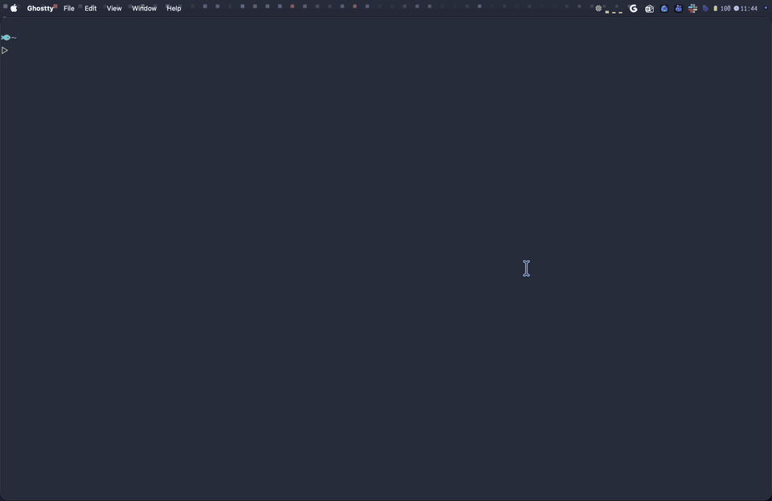
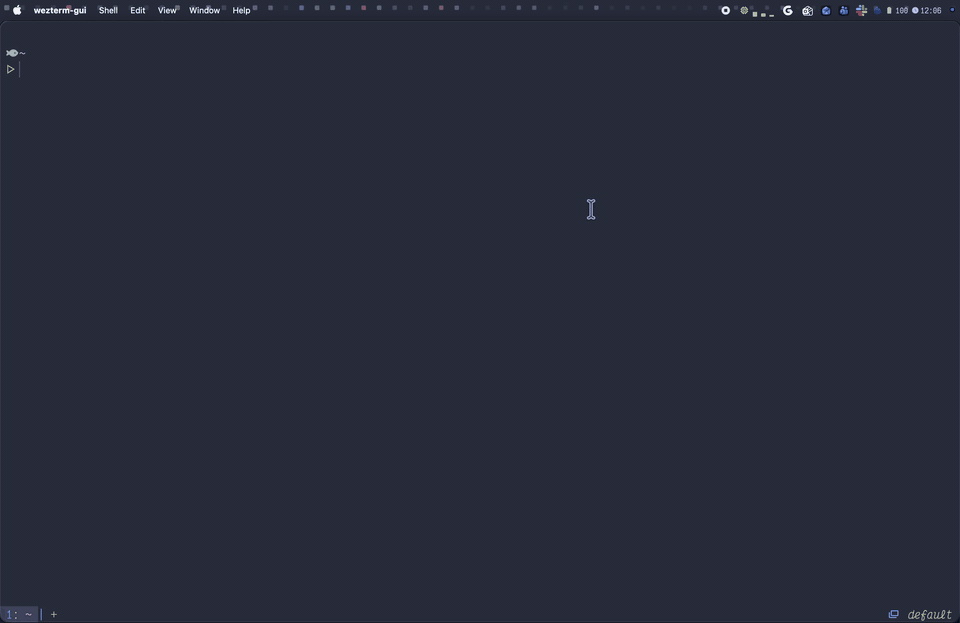
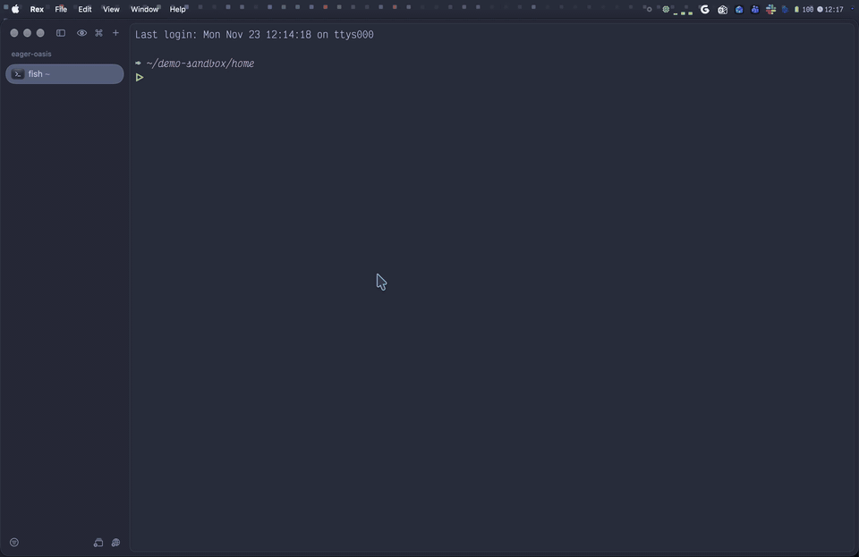

<p align="center">
  <picture>
    <source media="(prefers-color-scheme: dark)" srcset="docs/assets/zop-dark.svg">
    
  </picture>
</p>

# zop

Every project, ranked by use.

`zop` keeps one list of all your projects: the repos under your roots plus any extra paths. Projects [zoxide](https://github.com/ajeetdsouza/zoxide) has seen come first, in zoxide's order. Everything else follows, sorted by path. It also gives each project a stable, short-lived, private place for sockets, locks and logs.

```
zop list                         # every project, ranked
zop refresh --root ~/projects    # rescan roots, rewrite the index, prune stale tmp state
zop tmp ROOT nvim.sock --live    # per-project tmp path; succeeds if the socket is live
zop visit PATH                   # tell zoxide this project was opened
```


The recording is made in a sandbox of made-up projects. `scripts/demo/record.sh` regenerates `docs/assets/demo.cast`.

## In use

`zop` is not a switcher. It is the list behind one. Each tool below draws its own picker and calls `zop visit` after a choice. The projects, their order and their ids come from `zop`.

| Zellij, in Ghostty | WezTerm | Rex |
|:---:|:---:|:---:|
|  |  |  |

How each is wired up is on the [In use](docs/guide/in-use.md) page, with links to the scripts and configuration. Raycast, VS Codium and Emacs Projectile are not documented yet, but anything that can run a command and read lines can use `zop` now.

## Docs

The documentation is an [mdBook](https://rust-lang.github.io/mdBook/) under [`docs/`](docs/). Start at [`docs/introduction.md`](docs/introduction.md), or read it on GitHub Pages.

## Development

Tools and tasks come from [mise](https://mise.jdx.dev). Rust is expected from your own toolchain.

```
mise install            # mdBook (pinned) and node
mise run check          # lint, tests, and the docs checks
mise run docs:serve     # the book, with live reload
mise tasks              # everything else
```

## Licence

[MIT](LICENSE).
