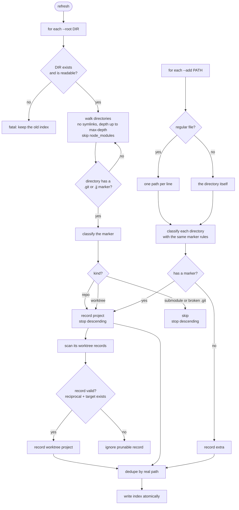
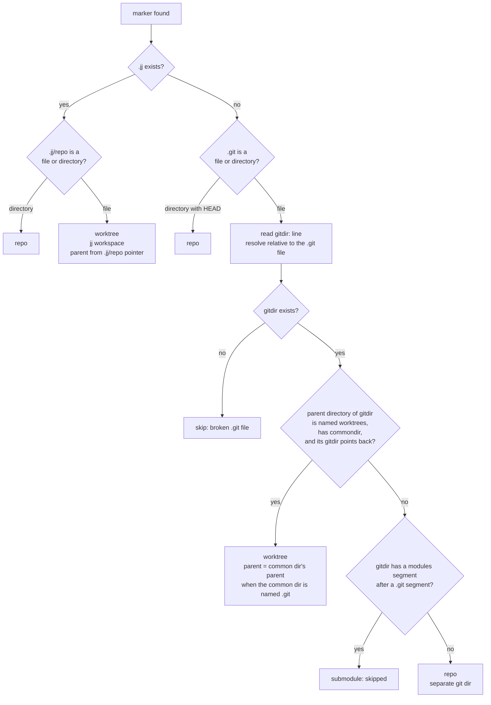

# Projects

A project is a **directory**. It has one of three kinds:

| Kind | What it is |
|---|---|
| `repo` | A git or jj repository root. |
| `worktree` | A linked git worktree or a jj workspace. It has a `parent` when the main checkout is in the index. |
| `extra` | A directory named explicitly with `--add` that has no repo marker, such as a notes vault. |

`zop refresh` discovers projects and writes them to the [index](../reference/index-file.md). `zop list` reads the index.

## Discovery

### Walk rules

- The walk **stops at the first marker**. It never descends into a project, so submodules and nested clones are excluded by construction.
- A `.git` directory only counts as a marker if it contains `HEAD`.
- Symlinks are not followed during the walk. A root itself and each `--add` path may be symlinks.
- Hidden directories are walked. `node_modules` is skipped.
- `--max-depth` (default 12) bounds the walk. Submodules are kept out by the stop-at-first-marker rule, not by the depth limit, and a test pins that behaviour.
- A root that is itself a project is included and not walked.
- A **missing or unreadable root is fatal**: the refresh stops and keeps the old index. A directory *inside* a root that can't be read only produces a warning on stderr.
- A missing `--add` directory, or a missing path inside an `--add` file, warns and is skipped.

### Classifying a marker

Classification is structural. It reads the marker and never runs `git`.

| Case | On disk | Result |
|---|---|---|
| Plain repo | `.git/` directory with `HEAD` | `repo` |
| jj, colocated | `.jj/` and `.git/` | one project, `repo` |
| jj, not colocated | `.jj/` only, `.jj/repo` is a directory | `repo` |
| jj workspace | `.jj/repo` is a file with a relative path to the main `.jj/repo` | `worktree` |
| Colocated jj workspace | `.jj/repo` file and `.git` file | one project. The jj result wins and `parent` comes from the jj pointer. |
| Linked git worktree | `.git` file, `gitdir: <main>/.git/worktrees/<name>` | `worktree` |
| Worktree of a bare repo | `gitdir: …/bare.git/worktrees/<name>` | `worktree` with `parent: null` |
| Worktree of a submodule | `gitdir: …/.git/modules/<sm>/worktrees/<name>` | `worktree` with `parent: null` |
| Submodule | `.git` file, `gitdir: …/.git/modules/<name>` | skipped |
| Separate git dir | `.git` file, `gitdir: /abs/path/foo.git` | `repo` (the default for unrecognised `.git` files) |
| Broken `.git` file | `gitdir:` target no longer exists | skipped |
| Subtree | no marker | nothing to do |
| Independent clone inside a project | never reached | excluded, because the walk stops at the outer project |
| `--add` directory with a marker | any of the above | classified like a walked directory |
| `--add` directory without a marker | none | `extra` |
| `--add` directory that is a submodule or has a broken `.git` file | skipped when walked | `extra`. Naming it explicitly beats the walk's rule. |

Relative `gitdir:` values (git 2.48 and later with `worktree.useRelativePaths=true`) and relative `.jj/repo` pointers resolve against the directory of the file that contains them.

### Parent

`parent` is the main checkout's path, and it is set **only when that path is in the index**. A worktree whose main repo is outside every root, or whose parent is a bare repo, has `parent: null`. Its id then follows the rule for worktrees without a parent. See [Ids](ids.md).

### Finding worktrees wherever they live

The walk finds worktrees that sit under a root. For worktrees anywhere else, `refresh` reads each repo's `.git/worktrees/*/gitdir` records, for repos found by the walk and by `--add`. A record is used only if:

- the target `.git` file still exists (a moved worktree leaves a prunable record behind), and
- the target's `gitdir:` points back at this record directory.

Non-colocated jj workspaces outside every root can't be found this way, because jj's workspace store isn't a simple format. That is a known limitation.

### Dedupe, spelling and precedence

- The **real path** is the dedupe key. On macOS `realpath(3)` also normalises letter case (checked: `casedir` resolves to `CaseDir`), so a mis-cased spelling matches.
- The printed `path` is the **path as discovered**, keeping the spelling of the root or `--add` argument. If `~/projects` is a symlink, `~/projects/foo` is printed as such and the real path is only the key.
- If the same directory comes from more than one source, a path under a root beats an `--add`, and a classified `repo` or `worktree` beats `extra`.

### Test fixtures

The discovery tests build these layouts with real `git` and `jj`:

- main repo plus a linked worktree
- the same with relative worktree paths
- `--separate-git-dir`
- a submodule, and a worktree of a submodule
- a bare repo plus a worktree
- a colocated jj repo plus a workspace
- a non-colocated jj workspace
- a symlinked root
- a moved worktree whose record is prunable
- a broken `.git` file
- an `--add` directory that is a repo with worktrees
