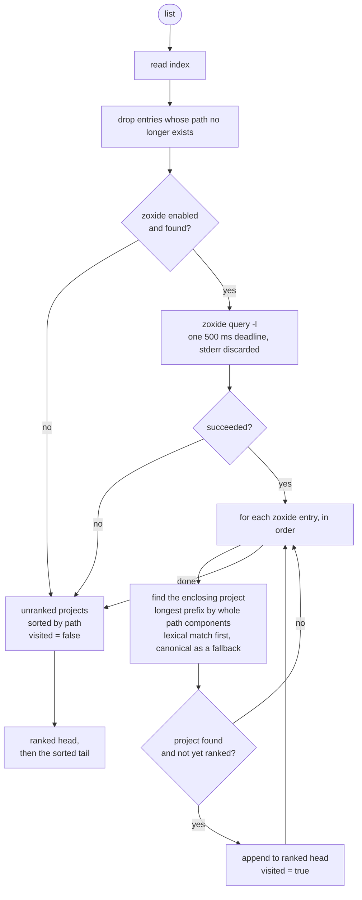
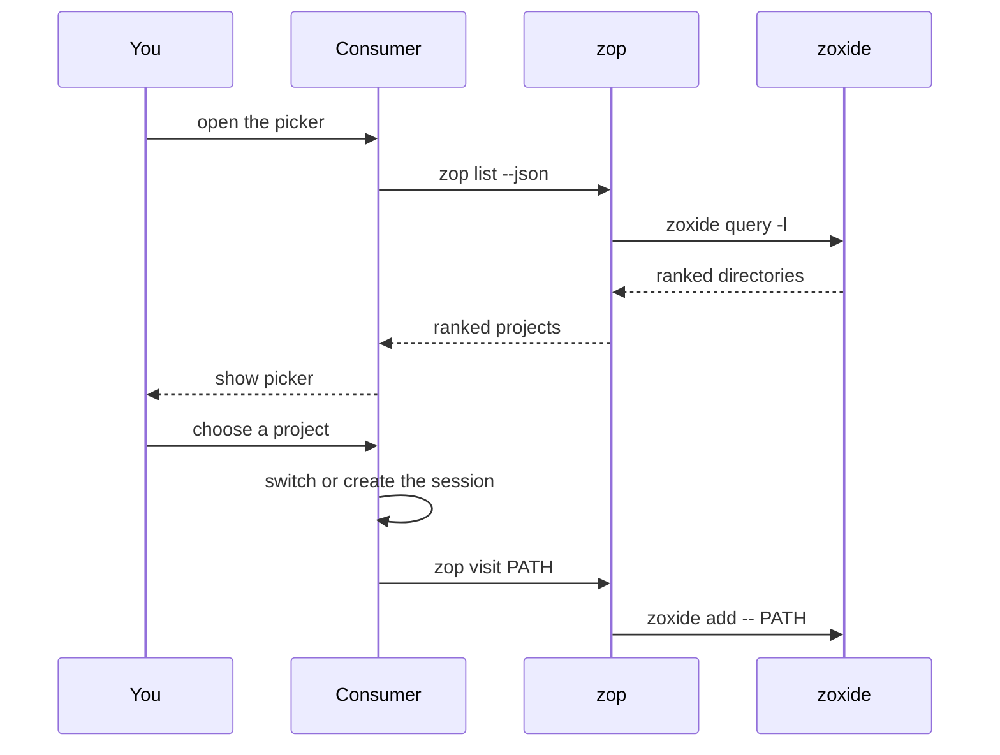

# Ranking and Visits

```
zop list = [projects zoxide has seen, in zoxide's order]
         + [every other project, sorted by path]
```

zoxide orders by **frecency**: a mix of how often and how recently a directory was visited. The rest of this book says "frecency" where it means that order.

## The algorithm



### Details

- **Enclosing project.** zoxide only records directories you `cd` into. Working in `~/commons/.config/nvim` never records `~/commons`. Each zoxide entry is therefore mapped to the project that contains it. A project ranks by its best-scoring entry.
- **Whole components only.** The prefix match compares path components, so `/a/foo` never matches `/a/foobar`.
- **Lexical first.** `zop` first tries a plain match of the zoxide path against each project's `path` and `realpath`. Only an entry that matches nothing is canonicalised, and an entry that fails to canonicalise is skipped. That avoids stalling on a stale network mount.
- **Tail order.** The tail is sorted by path, byte order. A worktree sorts directly after its parent when the parent is in the tail, so a repo and its worktrees stay together.
- **One deadline.** The 500 ms covers both the process exiting and its output reaching end of file. A wrapper script that exits while a child still holds the output open is cut off, and the whole process group is killed. A read error gives `failed`, never partial output.
- **Degrading.** If zoxide is missing, disabled with `--no-zoxide`, slow past the deadline, or fails, `zop list` returns the sorted list and every `visited` is `false`. Nothing is printed to stderr in that case. The JSON envelope's `zoxide` field says which of `ok`, `disabled`, `missing` or `failed` happened, so a GUI consumer that can't find zoxide is noticeable.
- **Finding zoxide.** `--zoxide-path` or `ZOP_ZOXIDE`, then `zoxide` on `PATH`, then `/opt/homebrew/bin`, `/usr/local/bin` and the `mise` shim. GUI apps often start with a minimal `PATH`.
- **No database access.** `zop` runs `zoxide query -l`. It never opens `db.zo`.

## `zop visit`

zoxide learns from shell hooks, so it only hears about a directory when a shell changes into it. A project opened by a launcher or a workspace manager gets no `cd`, so it never rises in the ranking.

`zop visit PATH` fixes that. It runs `zoxide add -- PATH` for one directory. Each consumer calls it after the user picks a project.



- It is the only place `zop` writes to zoxide, and it writes one path at a time.
- It always exits 0. If zoxide can't be found it warns on stderr, so a lost visit is noticeable, and a failing `zoxide add` warns too.
- It doesn't require PATH to be in the index. Using a project is what makes it a visit.
- `p` doesn't need it, because it ends in `z <dir>`, which records the visit itself.
- A tool that already runs `zoxide add` itself should replace that call with `zop visit`, not add to it, or the visit counts twice.

## Why not `zoxide add` on everything

Registering every project with zoxide on each refresh raises every score by the same amount, so a visited project cannot be told apart from a never-visited one, and ties come out in arbitrary order. `zop` ranks by what zoxide has really seen and sorts the rest by path. See [Why zop](../guide/why-zop.md).
