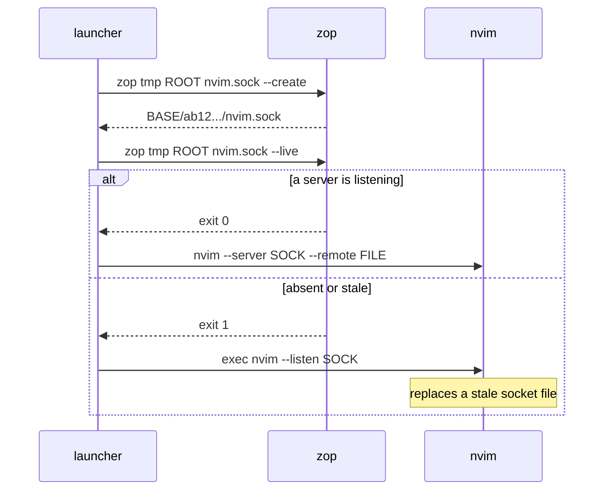

# Per-project tmp

`zop tmp` gives every project a short-lived directory for things that shouldn't live in the repo: sockets, locks, logs.

```
zop tmp PATH [NAME]   →   <BASE>/<hash16>[/NAME]
```

- `hash16` is the first 16 hex characters of SHA-256 over the real path of `PATH`.
- `PATH` is a project root, taken exactly as given and then resolved to its real path. It does not search upward to an enclosing project, so calling it from a subdirectory gives a different directory. Pass the project root (for example `git rev-parse --show-toplevel`).
- `NAME` is one file name, and what it holds is up to the caller. `nvim.sock` is the nvim socket. `lock` or `server.log` need no change to `zop`. The name `path` is reserved for zop's own marker and is rejected.

The motivating case is nvim. A socket inside each repo litters it, leaves stale files, and can't hold a long path, because macOS limits a unix socket path to 104 bytes. A short, predictable path outside the repo avoids all three, and every reader and writer computes the same one.

## Where `BASE` is

`zop` picks the first of these that leaves room for a socket path:

1. **`$ZOP_TMP_ROOT/zop-<uid>`**, if `ZOP_TMP_ROOT` is set. This is an override, used by the tests.
2. **`<private dir>/zop`**, where the private dir is the user's own temporary directory. On macOS it is the per-user directory from `confstr(_CS_DARWIN_USER_TEMP_DIR)`, which looks like `/var/folders/xx/…/T/`. On other systems it is `$XDG_RUNTIME_DIR`. Both are mode 0700 and owned by you, so no other user can list or reach them.
3. **`/tmp/zop-<uid>`**, when there is no private dir or it is too long.

macOS asks the system for its directory instead of reading `$TMPDIR`. A GUI app started by launchd can have a different `$TMPDIR` from your shell, and every reader and writer has to compute the same path.

A unix socket path is limited to 104 bytes on macOS. The private dir on macOS is 49 bytes, so `<private dir>/zop/<hash16>/nvim.sock` is about 82 bytes. `zop` falls back to `/tmp` when the base leaves less than 34 bytes of room for the hash and a name. `zop tmp` also errors if the final path exceeds 100 bytes, measured on the printed string, so a long `NAME` can't silently break `nvim --listen`.

On Linux, a process without `$XDG_RUNTIME_DIR` falls back to `/tmp/zop-<uid>` and so computes a different path from one that has it. Give such processes the same environment, or set `ZOP_TMP_ROOT` for all of them.

Nothing here survives a reboot, and nothing should. A socket outlives only the process that listens on it, and the system may clear its temporary directory. `zop refresh` prunes whatever is left.

## Safety

The fallback `/tmp` is world-writable and `zop-<uid>` is predictable, so another user could pre-create it, or plant a socket where your client expects one. The private directories are not exposed in that way, but `zop` makes the same checks everywhere.

- `BASE` is created with a single `mkdir` at mode 0700. It is never created recursively, so a missing parent is an error.
- On every use, `zop` checks with `lstat` that `BASE` and the hash directory are real directories (not symlinks), owned by the effective uid, with no group or world permissions. Otherwise it errors.
- `NAME` must be a single path component. Empty names, `.`, `..`, anything containing `/`, NUL, and the reserved name `path` are rejected. `--live` checks the whole path the same way `tmp` does, so a name that makes the path too long is an error, never "live".
- Consumers use `zop list --live NAME` or `zop tmp --all NAME`, never a glob over `BASE`. A glob bypasses these checks.

## `--create`, `--live` and `--all`

`--create` and `--live` are mutually exclusive. `--all` takes no `PATH`.

| Flag | Behaviour |
|---|---|
| (none) | Prints the path. The directory may not exist. |
| `--create` | Creates the hash directory at mode 0700 and writes a `path` marker file containing the project's real path. The `NAME` itself isn't created. |
| `--live` | Needs a `NAME`. Exits 0 only if a unix socket there accepts a connection within a short timeout (200 ms). **Read-only**: it never removes anything. |
| `--all NAME` | Prints every existing `BASE/*/NAME`, found by scanning the owner-checked hash directories. With `--live`, only the sockets that accept a connection. It needs no project list, so it also reaches a project that isn't in the index. |

### Creating the directory atomically

`--create` makes `<hash>.tmp.<pid>` at mode 0700, writes the `path` marker inside it, then renames it to `<hash>`. A concurrent prune therefore never sees an empty, markerless directory. If the rename finds the directory already there, the temporary one is discarded and the existing one is used.

### Why `--live` is read-only

A socket that is bound but not yet listening refuses connections exactly like a dead one. If `--live` unlinked on refusal, a starting nvim could have its socket deleted and keep running unreachable. A connect that doesn't answer in time, or fails for any reason other than a refusal or a missing path, counts as **live**, so a busy or stopped nvim is never mistaken for a dead one. So `--live` reads, with a timeout, and cleanup happens elsewhere.

The standard library has no connect timeout, so the connect runs on a helper thread (or a non-blocking `connect` plus `poll` through `libc`) and the caller waits at most 200 ms.

## Cleanup happens in `zop refresh`

There is no separate prune command. An explicit `zop refresh` prunes, and `--no-prune` skips it. An implicit refresh from `list` does not prune. `zop` only touches entries named the way it names them: `<hash16>` (16 lowercase hex digits) and `<hash16>.tmp.<pid>`. Anything else under `BASE`, such as a directory named `backup.tmp.old`, is left alone. A problem with one entry is a warning on stderr and does not stop the rest. For each `BASE/<hash>/`:

1. **Sockets.** Remove one only if **all** hold: it is a socket owned by you; its `lstat` modification time is **more than 10 seconds old**; a stream connect is **explicitly refused** (`ECONNREFUSED`), and a second connect 100 ms later is refused too; and an `lstat` immediately before the `unlink` shows the same device and inode as the first. A timeout, or any other error, does not count as a refusal. A live datagram socket, for example, can't be probed with a stream connect, so it is never removed. The last check narrows the window in which a new nvim could have replaced the socket between the decision and the unlink. A small window remains, and it is documented rather than eliminated.
2. **Orphans.** If the project path in the `path` marker no longer exists, remove the plain files in the directory that are more than 10 seconds old. This clears the orphan left when a project is moved or renamed. The marker is removed last, and only when nothing else is left, so a recent file never strands a directory that a later pass would no longer recognise as an orphan. A path that can't be checked, such as one on an unmounted volume, is not treated as gone.
3. **Empty directories.** Remove empty hash directories more than 10 seconds old, and leftover `<hash>.tmp.<pid>` directories more than a minute old. A leftover temporary directory is removed only if it holds nothing but the `path` marker. The removal is never recursive.

A project that isn't in the index is not pruned for that reason alone. An editor can use a repo that lives outside every root. The only test is whether its path still exists.

`zop` doesn't rely on the system clearing its temporary directory; pruning works either way.

## What a moved project does

The hash is of the real path, so a moved project gets a new directory. A running nvim keeps its old socket, `--live` reports no nvim at the new path, and the next launch starts a second one. The old directory is removed by a later `refresh` once its socket dies. This is documented behaviour, not a bug to fix.

## nvim and stale sockets

`nvim --listen <path>` on a path with a stale socket file starts normally and replaces the file (checked on nvim 0.12.6). It does not fail with "address in use", so a launcher needs no cleanup before it listens. What it needs is a **real liveness check**, not `[ -e "$sock" ]`. With `-e`, a stale socket sends `--remote` to a dead server, which fails silently and never starts nvim.

Also, on macOS, connecting to a listening socket whose backlog was never drained did not return `ECONNREFUSED`. Eight non-blocking connects to a `listen(0)` socket all succeeded, so a busy nvim isn't mistaken for a dead one.



Exit codes: 0 live, 1 not live, 2 error.
