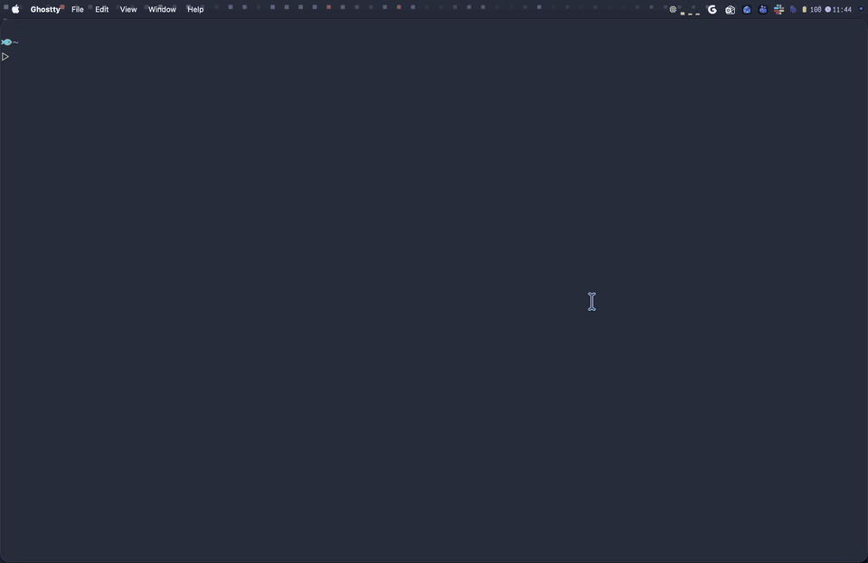
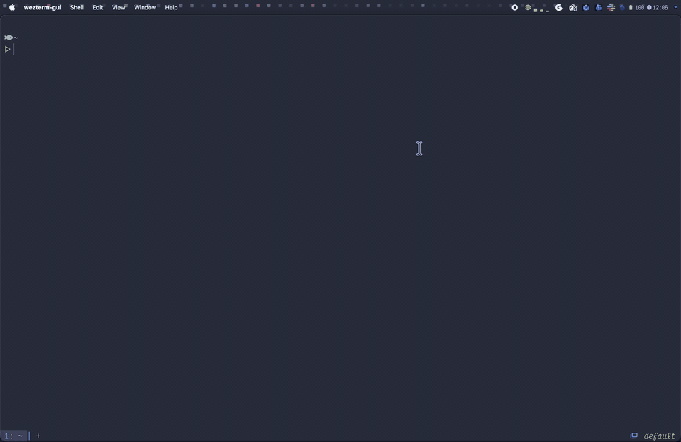
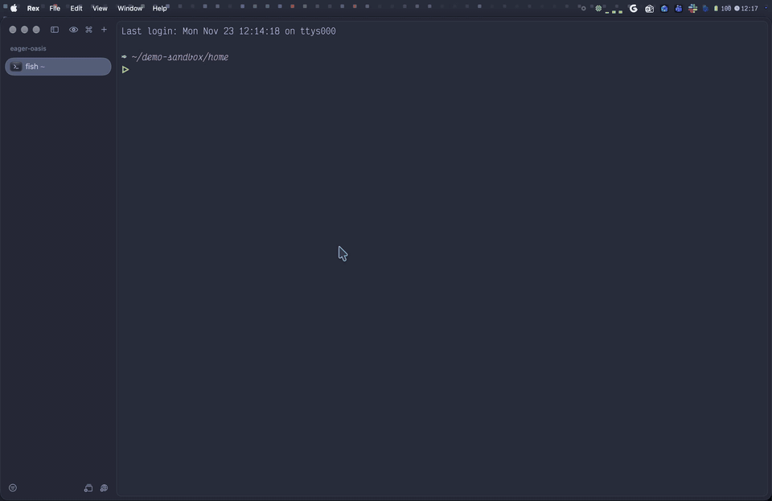

# In use

These recordings show `zop` feeding a project switcher. **`zop` is not the switcher.** It is the list behind one: the projects, their order and their ids. Each tool below draws its own picker, switches or creates its own workspace, and calls `zop visit` afterwards. The picker you see in each clip is that tool's.

All three recordings use a sandbox of made-up projects. Two of them are called `docs`, on purpose: `zop` gives them the ids `acme~docs` and `jdoe~docs`, so a session or workspace named by id never collides.

## What each tool does with zop

Every one of them does the same three things:

1. Asks `zop list --json --no-tilde` (or plain `zop list`) for the ranked projects.
2. Shows them in its own picker.
3. Calls `zop visit PATH` on the choice, so the project rises in the ranking.

The clips are short and the setups are small. Read the linked files to see exactly how each is wired.

## Zellij, in Ghostty



A floating pane runs a fish script. It merges the running Zellij sessions with `zop list --json`, shows the result in `fzf`, and starts or attaches to a session named by the project's `id`. A session whose project has a live nvim is marked, using `zop list --live nvim.sock`.

- The script: [`zellij-project.fish`](https://github.com/theherk/commons/blob/57d8b6b/bin/zellij-project.fish)
- The Zellij config that binds it: [`config.kdl`](https://github.com/theherk/commons/blob/57d8b6b/.config/zellij/config.kdl)

## WezTerm



[smart_workspace_switcher.wezterm](https://github.com/theherk/smart_workspace_switcher.wezterm) draws a fuzzy picker of workspaces and projects. It takes a `list_command` and a `visit_command`, so it can read from `zop` and not from `zoxide`:

```lua
workspace_switcher.list_command = "zop list --no-tilde"
workspace_switcher.visit_command = "zop visit"
```

The picker shows paths in this recording because the sandbox lives in a long directory. Your own would show `~/...`.

- The plugin, and how to configure it: [its README](https://github.com/theherk/smart_workspace_switcher.wezterm#using-another-project-list)
- How it is wired up: [`workspace.lua`](https://github.com/theherk/commons/blob/57d8b6b/.config/wezterm/workspace.lua)

## Rex



[Rex](https://superlogical.com/rex/docs) runs an action written in Lua. The action calls `zop list --json --no-tilde`, offers the projects in Rex's native picker, and opens a session named by the project's `id`. `zop list --live` marks the sessions whose project has a running nvim.

- The action: [`workspace.lua`](https://github.com/theherk/commons/blob/57d8b6b/.config/rex/workspace.lua)

## Other tools

`zop` only prints a list, so anything that can run a command and read lines can use it. These recordings cover three tools. I may add instructions for more, such as Raycast, VS Codium and Emacs Projectile. They should work with `zop` already: call `zop list` for the projects, and `zop visit` after the choice.

See [Integration](integration.md) for the general shape.
