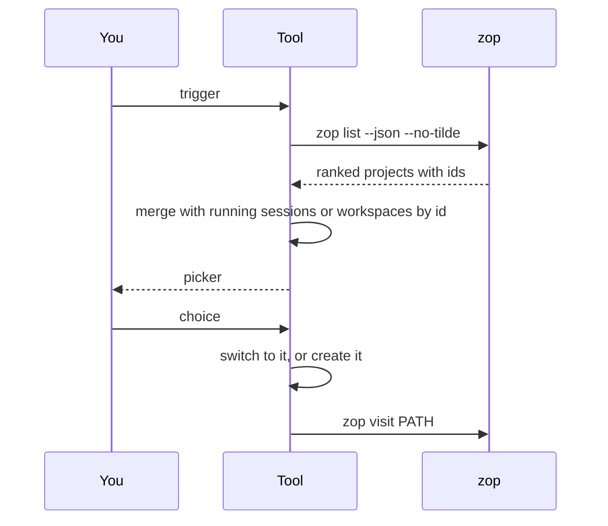

# Integration

Every tool follows the same shape. It asks `zop` for the list, shows a picker, switches to the choice, and tells `zop` about the visit.



## Pickers

```
zop list --tilde | fzf --reverse
```

Plain output is one path per line. Use `--json` when you need ids, kinds or the rank. Scripts pass output flags explicitly (`--no-tilde`, `--json`) and don't rely on a user's config for the shape of the output. See [Configuration](../reference/configuration.md).

Name sessions and workspaces by `id`, so that every tool agrees on what a project is called. Picking by `{id, path}` pairs also removes any need to resolve a name back to a path.

`p`-style shell functions that end in `z <dir>` don't need `zop visit`, because `z` records the visit itself.

## Tools that never `cd`

Launchers, workspace managers and editors that open a project without changing directory should call `zop visit PATH` after the choice. Without it, zoxide never learns about the project.

If such a tool already runs `zoxide add` itself, replace that call with `zop visit`. Doing both counts the visit twice.

## GUI applications

Applications started by the desktop usually have a minimal `PATH` and none of your shell's `XDG_*` variables. Set `ZOP_ZOXIDE`, `ZOP_INDEX` and `ZOP_CONFIG_PATH` explicitly for them, and check the JSON `zoxide` field once, so a missing zoxide doesn't go unnoticed. See [Commands](../reference/commands.md#global-flags).

## Refreshing

Run `zop refresh` on a schedule, or put `--refresh-if-older=1d` in the `[list]` section of the config, so that `list` refreshes a stale index itself. The index remembers the inputs of the last refresh, so neither needs the roots repeated.

## Editor sockets

Have the editor listen on a path from `zop tmp`:

```
sock=$(zop tmp "$root" nvim.sock --create)
if zop tmp "$root" nvim.sock --live; then
  nvim --server "$sock" --remote "$file"
else
  exec nvim --listen "$sock" "$file"
fi
```

A tool that must reach every running editor, for example to push a colour scheme, uses `zop tmp --all nvim.sock --live`. It prints one socket path per line, including editors started in repos outside every root.

See [Per-project tmp](../concepts/tmp.md).
