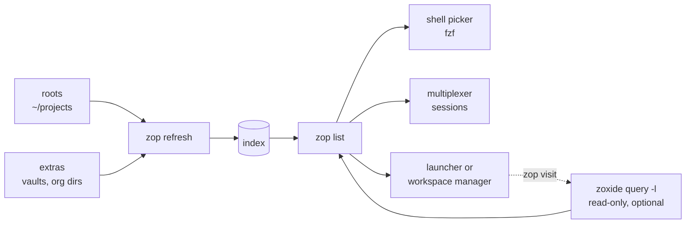

<p align="center">
  <picture>
    <source media="(prefers-color-scheme: dark)" srcset="assets/zop-dark.svg">
    
  </picture>
</p>

# zop

`zop` keeps one list of **all your projects**, ranked by how much you use them. Projects [zoxide](https://github.com/ajeetdsouza/zoxide) has seen come first, in zoxide's order. Everything else follows, sorted by path. It also gives each project a short-lived, private place for sockets, locks and logs.

Every "go to a project" action has the same three steps:

1. **Gather:** every repo under your roots (for example `~/projects`) plus a few extra places such as vaults.
2. **Rank:** visited projects first, the rest after.
3. **Act:** pick one, then `cd`, open a session or workspace, open an editor, or copy the path.

Only the third step differs between tools. `zop` does the first two, so a shell function, a terminal multiplexer script, an editor plugin and a launcher can each stay a few lines long.




## The four commands

```
zop list                       every project, ranked
zop refresh --root ~/projects  rescan roots, rewrite the index, prune stale tmp state
zop tmp ROOT nvim.sock --live  per-project tmp path; succeeds if a socket there is live
zop visit PATH                 tell zoxide this project was opened
```

Running `zop` with no command is `zop list`.

## The ranking rule

```
zop list = [projects zoxide has seen, in zoxide's order]
         + [every other project, sorted by path]
```

The list is always complete. Without zoxide you get the sorted list. `zop` never reads or writes zoxide's database file. The one write is explicit: `zop visit` runs `zoxide add` for a single path you opened.

## Design principles

- **One source of truth** for what a project is, how projects are ranked, and what to call them.
- **Thin consumers.** `zop` knows nothing about multiplexers, launchers or editors. They ask for a list and act on it.
- **ripgrep's model for flags.** Booleans come in `--x` / `--no-x` pairs where the last one wins, and a config file supplies defaults that the command line overrides.
- **Read-only by default.** `list` only writes when it has to refresh a missing or stale index. Otherwise only `refresh`, `tmp --create` and `visit` change anything.

## Reading this book

- [Why zop](guide/why-zop.md) explains the problems it solves.
- [Integration](guide/integration.md) shows how a tool calls `zop`.
- [Concepts](concepts/projects.md) explains what a project is, how ranking and ids work, and how the tmp area behaves.
- [Reference](reference/commands.md) is the exact command, config, JSON and index contract.
