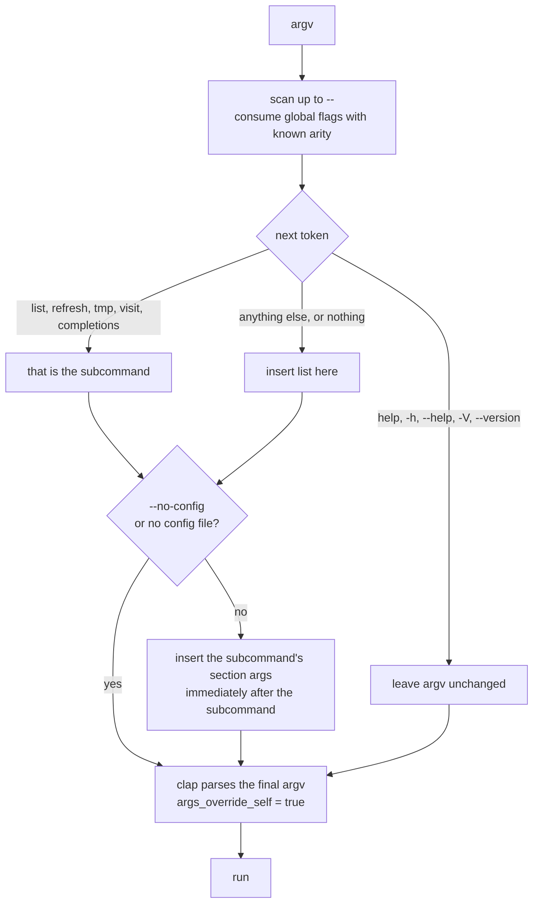

# Configuration

A naked `zop refresh` should do something sensible, the way a naked `rg` does. The config file supplies defaults. The command line overrides them.

## Format

The file is `$XDG_CONFIG_HOME/zop/config`, defaulting to `~/.config/zop/config`. It is **sectioned**, and each section holds CLI arguments:

```
# ~/.config/zop/config

[refresh]
--root=~/projects
--add=~/commons/.projects-extra

[list]
--refresh-if-older=1d
```

- One argument per line, written as `--flag` or `--flag=value`. Space-separated values are not supported.
- Blank lines and lines starting with `#` are ignored.
- The only sections are `[list]` and `[refresh]`. Any other section is an error, and so is an argument before the first section.
- `~` and `$VAR` expand as they do on the command line. A literal `$` is written `\$`. An undefined `$VAR` is an error that names the variable.
- Global settings (`--index`, `--config`, `--zoxide-path`) are not read from the file. Set them with the flag or the environment.

## Precedence

```
command line  >  environment  >  config file  >  defaults
```

The environment variables are `ZOP_CONFIG_PATH`, `ZOP_INDEX` and `ZOP_ZOXIDE`. They only affect global settings, so they never compete with config arguments.

## How the config is applied

A flat file whose arguments are prepended, as ripgrep does it, can't work here, because `--root` belongs to `refresh` and ripgrep has no subcommands. `zop --root=… refresh` would be rejected before reaching the subcommand. Instead, `zop` rewrites argv before clap sees it.



The global flags with known arity are `--config V` or `--config=V`, `--no-config`, `--index V` or `--index=V`, and `--zoxide-path V` or `--zoxide-path=V`. Scanning stops at `--`. A value consumed by a global flag is never mistaken for the subcommand.

With `[list] --refresh-if-older=1d` in the config:

| You type | `zop` runs |
|---|---|
| `zop` | `zop list --refresh-if-older=1d` |
| `zop --json` | `zop list --refresh-if-older=1d --json` |
| `zop --live nvim.sock` | `zop list --refresh-if-older=1d --live nvim.sock` |
| `zop --index ~/x list` | `zop --index ~/x list --refresh-if-older=1d` |
| `zop --config F refresh --root R` | `zop --config F refresh <[refresh] args> --root R` |
| `zop --help`, `zop -V` | unchanged |

The config's arguments come right after the subcommand, so anything you type is later and wins. Clap is set to `args_override_self(true)`, which lets a later value flag replace an earlier one. Every value flag that the config can set also has a way to cancel it from the command line: `--no-refresh-if-older`.

## Rules

- **Booleans need a negation.** Every toggle that can appear in the config has a `--no-x`: `--tilde`, `--json`, `--zoxide`, `--worktrees`, `--prune` and `--refresh-if-older`.
- **Repeatable flags can't be undone** from the command line. Use `--no-config`.
- **Missing file.** The default path may not exist. An explicit `--config` or `ZOP_CONFIG_PATH` that doesn't exist is an error.
- **The config feeds the implicit refresh.** When `list` has to refresh, it reads the `[refresh]` section, falling back to the inputs stored in the index. See [Index and State](index-file.md).
- **Consumers should not trust the config for output shape.** A user's `--tilde` or `--json` in `[list]` changes what a script receives. Scripts pass `--no-tilde` / `--json` explicitly. The recommended config only holds refresh inputs and `--refresh-if-older`.

