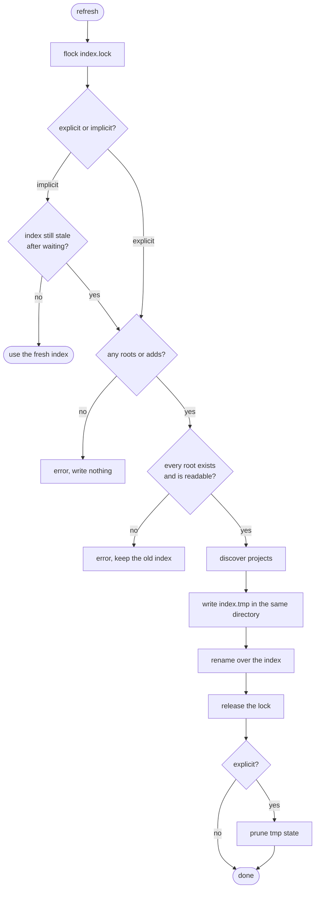

# Index and State

`zop` keeps two kinds of state. The index is durable. The tmp area is ephemeral.

## The index

| | |
|---|---|
| Location | `${XDG_STATE_HOME:-~/.local/state}/zop/projects`, or `--index` / `ZOP_INDEX` |
| Written by | `zop refresh`, explicit or implicit |
| Format | **Private**, versioned, tab-separated text. Read it through `zop list`, not directly. |
| Contents | The refresh inputs, then one line per project: `path`, `realpath`, `kind`, `parent`. No ranking and no zoxide data. |

The format, in outline:

```
zop-index 1
# root=/home/me/projects
# add=/home/me/.projects-extra
# max-depth=12
# worktrees=true
/home/me/projects/github.com/example/zop⇥/home/me/projects/github.com/example/zop⇥repo⇥-
```

Tabs, newlines and backslashes inside a path are escaped as `\t`, `\n` and `\\`. The `realpath` is stored so `list` doesn't canonicalise every project on every call.

### Remembering the inputs

The header stores the normalised inputs of the last refresh: roots, adds, `--max-depth` and `--worktrees`. They are what lets the index refresh itself without a config file:

- **An implicit refresh** from `list` (index missing, stale, or older in format) uses the config's `[refresh]` section if there is one, and otherwise the stored inputs.
- **A bare `zop refresh`** does the same, so it repeats what ran last.
- Command-line `--root` and `--add` are added to the config's. The stored inputs are used only when neither the config nor the command line gives any.

This makes the config genuinely optional, and it lets a format-version bump rebuild the index.

### Writing it safely



- **Atomic.** The index is written to a temporary file in the same directory and renamed over the old one. A reader never sees a partial file.
- **Never empty, never silently shrinking.** `refresh` refuses to write when it has no roots and no adds. It also refuses when a root is missing, unmounted or unreadable, and keeps the old index. Otherwise a drive that isn't mounted at login would quietly drop projects from every consumer. Unreadable directories inside a root only produce a warning on stderr.
- **Paths are kept byte for byte.** A path that isn't valid UTF-8 is written with `\xHH` escapes and read back exactly.
- **A damaged index is replaced, not fatal.** A file that can't be understood, including one that isn't valid UTF-8, counts as stale, and a refresh rewrites it. A file that can't be read at all, for example because of its permissions, is an error that names the file and the cause.
- **One refresh at a time.** The lock is `flock` on `<index>.lock`, next to the index. The file is never deleted, so a crashed refresh can't leave a stale lock.
  - An **explicit** refresh waits for the lock (30 s timeout), then runs its own refresh with its own inputs.
  - An **implicit** refresh waits, then re-checks the index's age and skips if another refresh has made it fresh. At login, several tools can all call `list` on a missing index at once, and only one refresh runs.
- **Pruning happens after the lock is released**, and only for an explicit refresh, so a waiting `list` never pays for socket connects.
- **Versioned.** The first line carries the format version. A different version is rebuilt from the stored inputs.

### Staleness

`list` skips entries whose path no longer exists, so a deleted clone vanishes at once. A newly cloned project appears at the next refresh. The intended setup is `--refresh-if-older=1d` in `[list]`, or `zop refresh` on a schedule.

## The tmp area

`<BASE>/<hash16>/` holds per-project ephemeral files, where `BASE` is the user's private temporary directory (see [Per-project tmp](../concepts/tmp.md#where-base-is)). It is created on demand, checked for ownership on every use, and pruned by `zop refresh`. See [Per-project tmp](../concepts/tmp.md).

## What `zop` never touches

zoxide's database. `zop` runs `zoxide query -l` to read and `zoxide add -- PATH` for `zop visit`. It never opens `db.zo`.

## Environment trap for GUI apps

An app started by launchd may not see your shell's `XDG_STATE_HOME`, `XDG_CONFIG_HOME` or `PATH`. It would then read a different index and config, or fail to find zoxide. Set `ZOP_INDEX`, `ZOP_CONFIG_PATH` and `ZOP_ZOXIDE` explicitly for those apps.
